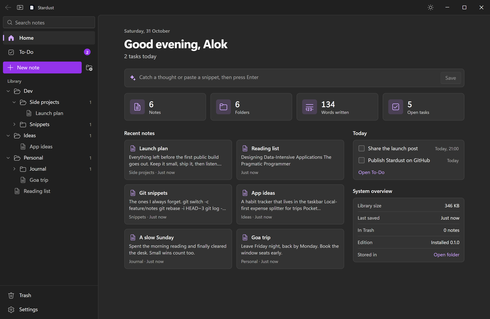
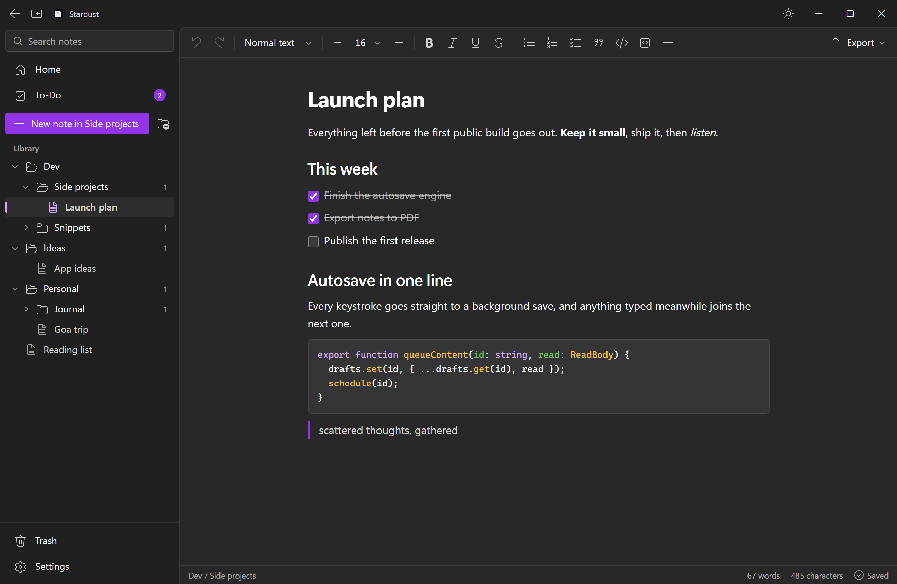
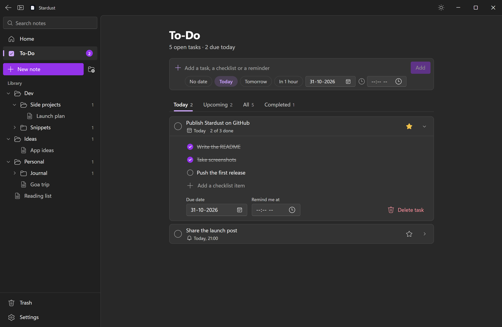
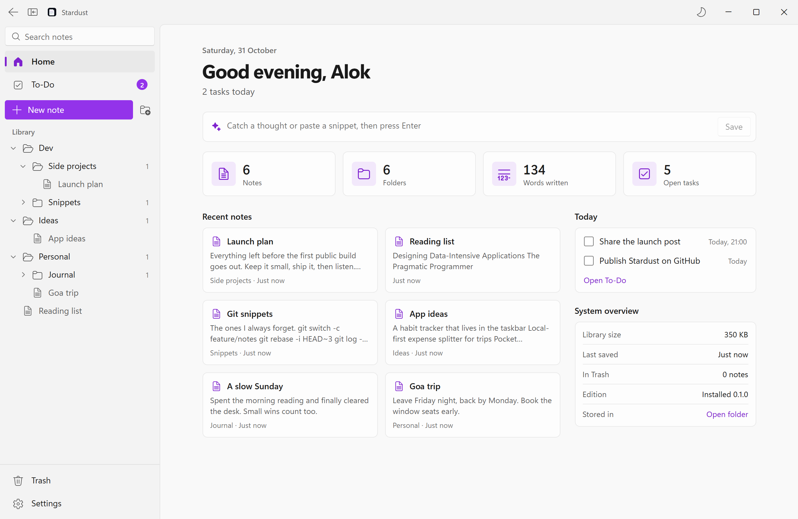
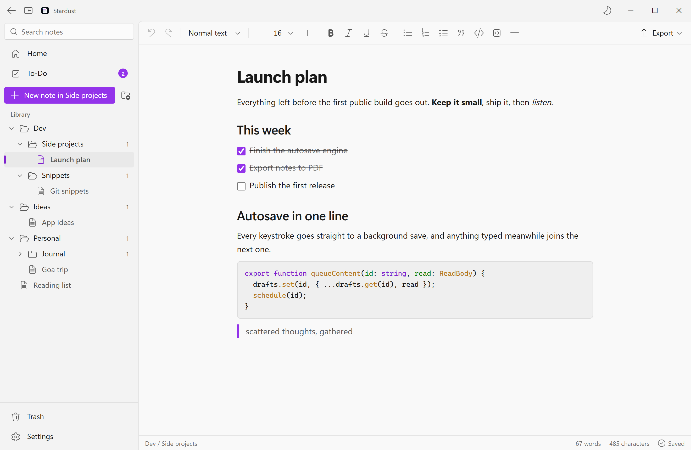
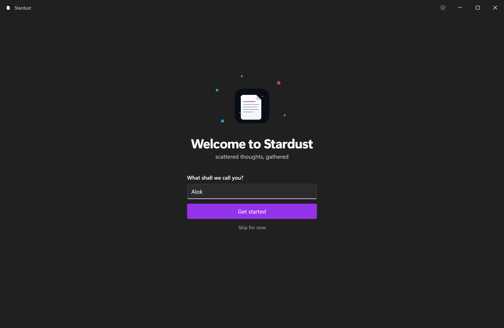

# Stardust

*scattered thoughts, gathered*

A lightning-fast, auto-saving desktop notebook for Windows, built with Tauri v2, React, TypeScript, Tailwind CSS and Rust.



## Download

Get the latest version from the [Releases page](../../releases/latest).

| File | Use it when |
| --- | --- |
| `Stardust_x.y.z_x64-setup.exe` | You want the normal installer |
| `Stardust_x.y.z_x64_en-US.msi` | You deploy with Windows Installer |
| `Stardust_x.y.z_x64_portable.exe` | You want to run it without installing, for example from a USB drive |

Builds aren't code-signed yet, so Windows SmartScreen may ask you to confirm before the first run.

## What it does

- **Saves as you type.** There is no save button and no save prompt. Every edit is written to disk in the background.
- **Nested folders.** Folders go as deep as you like. Drag notes and folders around the sidebar, or use their right-click menu.
- **Context-aware creation.** New notes land in the folder you're in, or in the root when you're on Home.
- **Rich text.** Headings, bold, italic, font sizes, lists, checklists, quotes and code blocks with syntax highlighting.
- **Snippet capture.** Paste anywhere outside a text box and it becomes a note. Pasted code becomes a code block.
- **To-Do.** Tasks, checklists, due dates and reminders with Windows notifications while the app is running.
- **Export.** `.txt`, `.md` and paginated `.pdf`.

## Screenshots

| | |
| --- | --- |
|  |  |
|  |  |

The first launch asks what to call you, and the dashboard greets you by that name.



## Development

```bash
npm install
```

```bash
npm run tauri dev
```

## Packaging

```bash
npm run dist
```

This writes the NSIS installer, the MSI and the portable exe to `release/`. To build only the portable exe:

```bash
npm run dist:portable
```

## Publishing a release

The packages in `release/` are committed to the repository. Pushing a change to that folder on `main` or `master` runs `.github/workflows/release.yml`, which publishes the three packages for the version in `package.json` as a GitHub Release tagged `v<version>`. Nothing is rebuilt, so the downloads are exactly the files you pushed.

- For a new release, bump `version` in `package.json`, run `npm run dist`, and push.
- If you rebuild without changing the version, the push replaces the downloads on the existing release.

The workflow stops with an error unless all three packages for the current version are in `release/`. Delete packages from older versions when you bump, so they don't stay in the repository.

## Where your notes live

Everything is stored in a single SQLite file, `stardust.db`.

| Edition | Location |
| --- | --- |
| Installed | `%APPDATA%\com.stardust.notes` |
| Portable | A `Stardust Data` folder beside the exe |

The portable build is recognised by the word `portable` in its file name, so keep that word if you rename it. Set `STARDUST_DATA_DIR` to use a different location.

## Shortcuts

| Keys | Action |
| --- | --- |
| Ctrl+N | New note in the current folder |
| Ctrl+Shift+N | New folder in the current folder |
| Ctrl+K or Ctrl+F | Search |
| Ctrl+\\ | Show or hide the sidebar |
| Alt+Left | Go back |
| F2 | Rename the selected folder |
